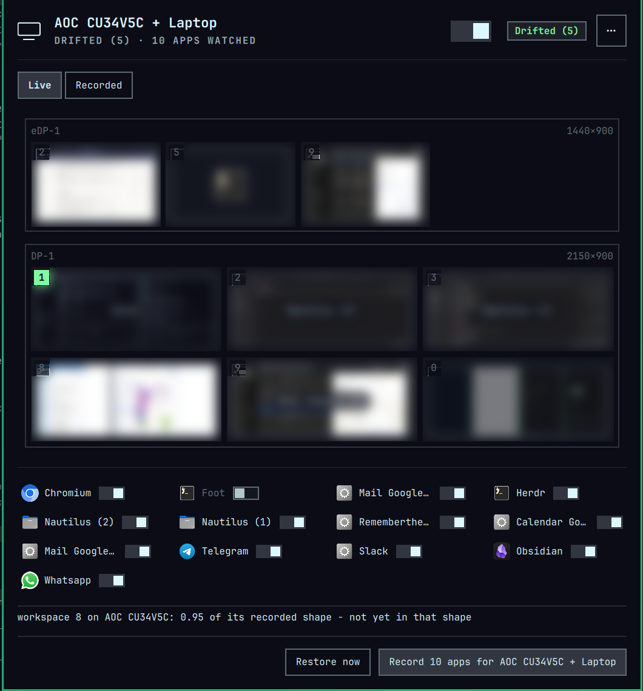

# Dock Recall

You use Omarchy differently with or without a monitor.

The frustration: undock, and Hyprland re-homes your windows onto the laptop
panel. Connect your monitor again and the windows stay on the laptop — piled
onto one screen, on the wrong workspaces, grouped (or not grouped) wrong — and
you spend the first minute of the session dragging them back and arranging it
"just so".

Dock Recall records how you like each situation set up, and your windows
auto-arrange to your preferred setup the moment the cable changes.



## Why you will want it

- **A layout per monitor setup.** Docked and undocked are recorded separately,
  keyed on your monitors' own EDID names, so the layout that comes back is the
  one you recorded for the setup you are actually in.
- **You choose what is watched.** Tick the apps you care about; everything else
  is left exactly where it is. A scratch terminal never gets moved because a
  restore ran.
- **It puts back more than the monitor.** Workspace, tab-group membership *in the
  recorded order*, floating geometry to the pixel, tiled shape and ratio.
- **It says so when it will not act.** Where the desktop cannot be read without
  guessing, the plugin refuses and the panel says why. Nothing is silently
  approximated into place.
- **Nothing is one-way.** Undo a recording right after you make it; a restore
  that could not place something lists the app and offers Retry; every recorded
  setup stays reachable from the panel.
- **Apps you closed come back too** — relaunched from a command derived from the
  process that was running, not from a guess, and landed in their recorded place
  rather than on whatever workspace has focus.
- **It stays out of the way.** No network access, no elevated privileges, no
  extra packages, no second Quickshell process. It reads `hyprctl`, writes one
  state file, and shows a toast only when it actually did something.

## Requirements

- Omarchy Quattro with third-party shell plugins (Hyprland 0.56)
- No AUR package, no runtime network dependency, no privileged helper

## Install

```bash
omarchy plugin add https://github.com/mkelk/dock-recall.git --enable
```

The bar widget defaults to the right-hand system cluster. To place it yourself:

```bash
omarchy bar move mkelk.dock-recall --section right --index 0
```

Confirm it loaded:

```bash
omarchy plugin list | grep mkelk.dock-recall
```

A service plugin needs a shell restart to become fully live the first time —
`omarchy restart shell` — after which `[dock-recall] service-ready` appears in
`qs log -p "$OMARCHY_PATH/shell"`.

### Update

```bash
omarchy plugin update mkelk.dock-recall --yes && omarchy restart shell
```

### Remove

```bash
omarchy plugin remove mkelk.dock-recall
```

Removing the plugin leaves your recordings in
`~/.local/state/omarchy/dock-recall.json`. Delete that file too if you want them
gone.

## The idea in three lines

1. Tick the running apps you care about.
2. Arrange them how you like, with the monitor setup you care about active, and
   hit **Record layout**.
3. On the next attach or detach, the layout recorded for *that* topology comes
   back.

Open the panel by clicking the bar glyph, or bind a key to it:

```bash
omarchy-shell shell summon mkelk.dock-recall '{"focus":"restore"}'
```

The `{"focus":"restore"}` payload opens the panel with **Restore now** focused,
so the whole round trip is one keystroke and Enter. A bare `'{}'` just opens it.

## The bar glyph

The small monitor shape in the bar is the fastest read on what the plugin
thinks is happening:

| Glyph | Means |
|---|---|
| hollow outline | no layout recorded for the current monitor setup |
| solid | recorded, and the desktop matches it |
| solid + accent dot | recorded, but windows have drifted from the recording |
| solid + urgent dot | the last restore reported a failure |
| solid + sweep band | a restore cycle is running right now |

## The panel

- **Workspace map** — mini-monitors with true-proportion window chips. Hovering a
  chip highlights its row and the other way round.
- **App list** — every window Hyprland is showing, ordered monitor → workspace →
  position, with a tick per app. Unticked apps are ignored by every restore.
  Apps with several windows get one row per window.
- **Camera per app** — a second consent, separate from the tick, drawn as a small
  camera on every watched row. The tick lets Dock Recall **move** an app's
  windows; the camera lets it **photograph** them when you press Record, so the
  Recorded map can show the window even when the app is closed. It is off until
  you switch it on, it is per app, and switching it off again leaves the app
  watched. **Switching a camera off deletes that app's stored pictures, on every
  desk**, and the map stops drawing them at once. Unticking an app takes its
  camera consent — and its pictures — with it.
- **Recorded captures** — a chip on the Recorded tab draws the picture taken
  when you recorded, underneath its icon and its name, so a closed app is
  recognisable rather than a grey label. The pictures live in
  `~/.cache/omarchy/dock-recall/`, not in your recordings: delete that directory
  and the map goes back to icons with nothing lost. Forgetting a layout deletes
  its pictures, re-recording replaces them, and undoing a record takes them with
  it.
- **Asked once, with the pictures in front of you** — the first time a Record
  actually stores a picture, the panel shows you the pictures it just took and
  offers three answers: **Keep pictures**, **Not for these apps**, or **No
  pictures**. Not for these apps switches those apps' cameras off and deletes
  every picture of them, on every desk — the camera it withdraws is not a
  per-desk grant, so neither is the delete; No pictures switches every camera off
  and deletes every stored picture, on every desk. The answer lives in the state
  file, so it
  survives a shell restart and you are not asked again. Escape, or a click
  outside it, dismisses it *without* answering — the question is still owed, and
  it comes back at the next Record.
- **Record layout / Restore now** — record the current arrangement for the current
  topology, or replay the recording immediately without waiting for a cable.
- **Undo record** — immediately after recording, put the previous recording back.
  One shot, held in memory: a net under the moment you just had, not a history.
  Forgetting a topology is undoable the same way.
- **Failed list** — when a restore could not place something, the app is listed
  with a Retry button, reachable by pointer and by keyboard.
- **Overflow menu (`⋯`)** — every recorded topology, its glyph state, re-record
  and forget.
- **Pause / Activate** — stop reacting to monitor events without losing anything.
- Full keyboard navigation; Escape closes the panel.

While it is open the panel answers on the IPC target `dock-recall`, so a script
can ask what it is showing and switch which map it shows:

```bash
omarchy-shell shell summon mkelk.dock-recall '{}'
omarchy-shell dock-recall state              # JSON: the topology, and every chip and workspace
omarchy-shell dock-recall setView recorded   # or live
omarchy-shell dock-recall setPictured <row key> on   # the camera consent, or off
omarchy-shell dock-recall answerConsent keep         # or not-these, or none
```

That target exists only while the panel is up — the shell loads the panel on
summon and drops it on hide — and opening and closing stay the shell's own verbs
(`omarchy-shell shell summon|hide|toggle mkelk.dock-recall '{}'`).

Every restore runs three settle passes, at 1 s, 3 s and 7 s after the trigger, so
a monitor that takes two seconds to wake up is not a race. "Nothing happened" is
only true about ten seconds after a dock.

## Where it refuses

Refusals are the design, not gaps waiting to be filled. Each one is visible in
the panel with its reason:

- **Two identical monitors** — twin displays with the same EDID description cannot
  be told apart reliably, so the topology is refused rather than restored onto a
  coin flip.
- **A terminal running an ambiguous command** — see below.
- **Tiled shapes that differ by more than one split flip** — a single flipped split
  is repaired with one `togglesplit`; anything deeper is refused and tagged
  *shape differs* in the list, because a tiling tree is not addressable enough to
  reconstruct blindly.
- **Special workspaces** are filtered out at record time. Hyprland addresses them
  with relative selectors, and dispatching against them moves an innocent
  workspace while reporting success.
- **A locked session** — group joins and split flips are deferred and replayed at
  unlock instead of being dispatched into a lock screen.

## Terminal-hosted apps are known by their title

**A terminal-hosted app is identified by the title it was launched with.** A TUI
app running inside a plain terminal (say `herdr` typed into `foot`) is otherwise
invisible: the window is just class `foot`, indistinguishable from every other
terminal, and its `/proc` cmdline is the terminal's, not the app's. Launch it
with a title of its own and it becomes addressable:

```bash
foot --title=herdr herdr
```

The title rather than a window class of its own, because this way the **class
stays plain**. That command sets the window's `initialTitle` to `herdr` while its
`class` remains `foot`, so every window rule you already have for terminals keeps
applying to it — Omarchy's own
`o.window("(Alacritty|kitty|foot)", { scroll_touchpad = 1.5 })` included. Rename
the class instead and that rule stops matching: Hyprland full-matches an
unanchored window-rule regex, so neither `herdr` nor a compound `foot.herdr`
matches `(Alacritty|kitty|foot)`, and the window scrolls slower than a plain
terminal for no reason you can see from the outside.

`initialTitle` is fixed at the moment the window maps, so an app that renames
itself the instant it starts moves only its live `title`. A window's identity
never becomes time-varying.

The command **shape** differs per terminal, not just the title flag: foot and
kitty take a bare trailing command, Alacritty and Ghostty reject one and need
`-e`.

```bash
foot --title=herdr herdr          # foot, footclient
kitty --title=herdr herdr         # kitty
alacritty --title=herdr -e herdr  # Alacritty
ghostty --title=herdr -e herdr    # Ghostty
```

That means remapping whatever keystroke launches it. Until you tick it the panel
still draws that window as *Foot*, because a class is all it knows about a window
nobody has claimed. Tick it and the panel reads the title off the window itself,
proposes `{"patterns":["^foot$"],"titlePatterns":["^herdr$"]}`, writes that exact
command as the identity's launch in the same click, and restores the app like any
other. From then on the chip is named after the app rather than the terminal.

### The panel can usually write that command for you

If you tick a terminal window whose own command line is nothing but the terminal,
the panel looks at the terminal's **child process** — the thing actually running
inside it — and watches the app rather than the terminal. The identity it creates
is named after the child, matches the terminal class **and** the child's title,
and arrives with the launch command already filled in — title flag and the `-e`
that terminal needs included:

```json
{ "id": "herdr", "patterns": ["^foot$"], "titlePatterns": ["^herdr$"],
  "launch": "foot --title=herdr herdr" }
```

That is the point of the pair: a bare `^foot$` would claim every terminal on the
desktop, so the next window you opened would be "herdr" too. A plain interactive
shell in between is looked through, so `foot` → `bash` → `herdr` derives just as
well.

The window it derived from usually does not match that identity yet: a terminal
you typed `herdr` into has `initialTitle: "foot"`, and the pair asks for `herdr`.
So the panel carries a line naming the identity and the exact command to relaunch
with, and the line disappears the moment a window matches.

It only does this when the answer is **unambiguous — exactly one child**. A
terminal running two things, a shell with two jobs, a shell inside a shell, a
terminal sitting at an empty prompt, one whose child's command line cannot be
read, or one whose own command line cannot be turned back into a command that
runs is refused out loud: the tick writes nothing, the panel says which of those
it was and what to relaunch with, and nothing is guessed. It will **not** fall
back to a bare `^foot$` — an identity that claims every terminal and can only
ever start one of them is a worse answer than none. If you do want every terminal
window watched as one app, write that identity into the state file by hand.

Deriving one of two candidates would write a launch command that silently
reopens the wrong app, and you would only find out at the next restore.

In the recording, such a window is claimed by an identity that carries
`titlePatterns` — regex strings matched against `initialTitle` — beside the usual
`patterns`, which are matched against `class` and `initialClass`. An empty list
is no constraint on that axis; when **both are non-empty both must match**, so
`{"patterns":["^foot$"],"titlePatterns":["^herdr$"]}` means exactly "the foot
window titled herdr".

**The identity list is priority order and the first match wins**, so a wide rule
sitting in front of a narrow one swallows it. The panel will not write that
arrangement: a new identity goes to the front, except behind any identity it
would shadow. And where a list already holds one — a hand edit, or a file from
an older build — the panel names both identities and says no open window reaches
the one behind.

**Class matching still works**, and nothing about it changed. If you already
launch an app with a window class of its own, it keeps being matched and restored
exactly as before — a dedicated class simply stops being the documented answer
for terminal-hosted apps.

A launch command belongs to the **app**, not to one of its windows: if a recording
holds two windows of the same app and neither is running, the tool runs that one
command twice, waiting for each window to appear before starting the next. Apps
that need different arguments per window need a title per window — the same rule
again.

## What it touches

Everything Dock Recall does is local, unprivileged and inspectable:

| Path | What it holds |
|---|---|
| `~/.local/state/omarchy/dock-recall.json` | your recordings, one per topology |
| `~/.local/state/omarchy/dock-recall.status.json` | what the bar glyph reads |
| `~/.local/state/omarchy/dock-recall.trigger` | a one-shot restore request |
| `~/.local/state/omarchy/dock-recall-forensics/` | snapshots of restores that failed |

It runs `hyprctl` to read the desktop and dispatch moves, reads `/proc` and
`.desktop` files to derive launch commands, and calls `notify-send` for the
restore toast. It makes no network requests, asks for no privileges, installs
nothing, and never writes to your Hyprland or Omarchy configuration.

## How well does it actually work?

The measurement surface is [`scripts/verify`](scripts/verify): it prints a
recorded-vs-live table for the current topology and exits 0 only when every
watched window is where the recording says it should be, with floating windows
inside a ±2 px tolerance and tiled windows scored by intersection-over-union.

Underneath that, every state the desktop can be in has a defined behaviour and a
test that pins it — including the ones the plugin deliberately refuses, which are
written down as refusals rather than left as gaps. `tests/` is where that
contract lives: a node suite over real `hyprctl` fixtures — the count is quoted
once, under [Development](#development), where the pre-release gate can check it
— plus `tests/sandbox-dock.sh`, which drives the plugin end to end — launch,
restore, no-op — inside a nested Hyprland the desktop it runs on never sees.

The behaviour has also been through a physical checklist on a real ultrawide over
a dock — cold dock, dock with the desktop deliberately scattered, undock,
undock while the session is locked, and suspend-dock-wake.

## Development

The brain is dependency-free ES5 JavaScript in [`engine.js`](engine.js),
[`StateModel.js`](StateModel.js) and [`PanelModel.js`](PanelModel.js) — no
QML, no clock, no I/O — so it is testable under node against real `hyprctl`
fixtures (see [`tests/fixtures/README.md`](tests/fixtures/README.md)):

```bash
node --test 'tests/**/*.test.js'   # 987 tests, no dependencies
omarchy plugin validate .          # manifest + entry points
qmllint -I "$OMARCHY_PATH/shell" *.qml   # every QML file, from a glob — never a list
./tests/sandbox-dock.sh            # end-to-end, in a nested compositor you never see
./scripts/dev-install --restart    # install this working tree and restart the shell
```

### `./tests/run-all.sh` — the pre-release gate

One command for the whole stack, cheapest tier first, and **every step runs even
after one fails**: the point of a pre-release pass is to learn everything that is
wrong in one sitting, not one thing per run. It prints a table and exits nonzero
if anything did. A real run of it, 2026-09-02:

```
#  STEP                                             RESULT   SECONDS
-----------------------------------------------------------------
1  node --test 'tests/**/*.test.js'                 PASS           0
2  omarchy plugin validate .                        PASS           0
3  qmllint (syntax) on the seven QML files          PASS           0
4  tests/sandbox-dock.sh                            PASS          31
5  tests/sandbox-future-version.sh --both           PASS          65
6  tests/sandbox-reserved-id.sh                     PASS          35
7  tests/acceptance/run.sh                          PASS         329
-----------------------------------------------------------------
   TOTAL                                            PASS         460

node suite: 835 tests passed, 0 failed
dock-recall full stack: PASS
```

That last line is why the count above is quotable at all: the summary reads the
suite's own footer, so the number in this file and the number the tests report
can be compared rather than trusted. It is quoted in exactly ONE place —
the command block above — because it has now drifted three times in one
increment, every time because two paragraphs said it. (The transcript is from
2026-09-02: it says 835, and its step 3 still names a hand-written file list,
which is now a glob.) About eight minutes, all of it headless. Step 7
needs `OMARCHY_ISO_HOST` (see
[`tests/acceptance/PROVISIONING.md`](tests/acceptance/PROVISIONING.md)), and
per-step logs land in a directory the summary names —
`DR_RUN_ALL_LOG_DIR` picks it, `DR_RUN_ALL_SKIP="4 5"` skips tiers that are
known-unavailable on a machine (a skipped step reports SKIP and never a pass).

What it deliberately does **not** run is `tests/sim-dock.sh`, or anything else
that drives the live session. Steps 4–6 park a second Hyprland on a special
workspace and assert your desk is untouched, and step 7 is a VM with
`-display none`; the live session is a venue to ask a human for, never a step in
an unattended gate.

**`tests/sandbox-dock.sh` is the end-to-end gate you run while you work** — the
one `run-all.sh` calls as step 4, and the one worth running on its own after any
engine or service change. It starts a second Hyprland
as a window parked on a special workspace nothing ever opens, hosts this working
tree's `Service.qml` and `Panel.qml` in a second Quickshell pointed at it, and
runs the three cases there: LAUNCH a missing app onto the recorded
workspace/monitor, put a SCATTERED window back, then do nothing at all. Every
path the plugin writes is redirected into a `mktemp` HOME, and the script ends by
asserting the live session is untouched — same active window, same monitors,
same visible workspaces, and a byte-identical
`~/.local/state/omarchy/dock-recall.json`. It needs no permission and no quiet
moment: run it from any working tree while you work. Exit 0 is the gate; a
failure keeps the sandbox directory and prints its path. Two caveats come with
running it alongside your work. **One run at a time** — a second concurrent run
stops with a busy message, because both would share one
`$XDG_RUNTIME_DIR/hypr`. And **two of the isolation checks can go falsely red**:
the active window and the visible workspaces are things *you* change by clicking
around, so the footer marks those two `[ambiguous]`, prints the before/after
delta, and tells you to rerun on an idle desk to confirm. The other three —
a stray sandbox window, the live state file, the monitor set — are
`[authoritative]`: nothing you do at your desk can produce them.

`tests/sim-dock.sh` is the same three cases against **your live session**, and it
is on-request only — it creates a headless output on your real desktop and moves
real windows, so **ask the human first**, run it alone, and never from two
working trees at once. Reach for it only when the sandbox cannot answer the
question: anything about your actual monitors, your actual `omarchy-shell`, or
the installed plugin rather than this tree.

`scripts/bench` measures restore quality — shape and ratio
intersection-over-union across recorded rounds — for when a change to the
placement planner needs a number rather than an opinion.

The repository root **is** the plugin folder, because `omarchy plugin add` clones
the repository and installs the clone root. Tests and scripts ride along; the shell
loads only the three entry points the manifest declares.

## License

MIT — see [LICENSE](LICENSE).
